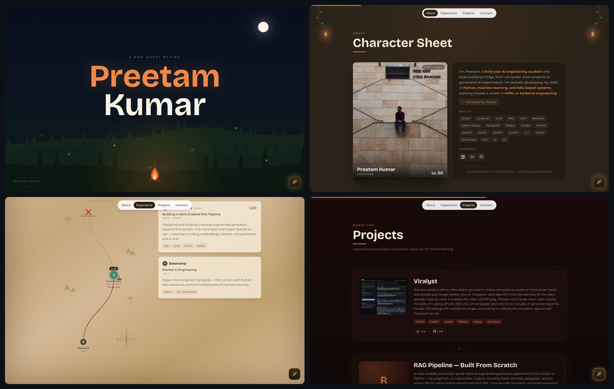

# Preetam's Portfolio

An adventure-themed portfolio: a WebGL night sky with shooting stars and a campfire, a character-sheet "About" card with a paint-reveal portrait, a treasure-map experience timeline with a scroll-driven ship, a quest-log of projects, and an AI chatbot that answers questions about me.

Built with Next.js, TypeScript, Tailwind CSS v4, Framer Motion, raw WebGL and the Claude API.

<p align="center">
  
</p>

## Editing content

Everything personal lives in **`src/data/profile.ts`**: name, bio, skills, achievements, experience, projects, and links. Edit it and the whole site (including the chatbot's knowledge) updates.

Images go in `public/`:

- `me.jpg` — portrait photo (4:5, e.g. 600×750)
- `me-alt.jpg` — optional alternate "fantasy" version with the same framing, revealed on hover. Without it, a golden-hour stylised version is generated automatically.
- `resume.pdf` — then set `resume: "/resume.pdf"` in the profile
- project screenshots — set `image: "/projects/name.png"` on a project

## Running locally

```bash
npm install
npm run dev
```

## 🖥️ Live Site

👉 [preetam-portfolio-wheat.vercel.app](https://preetam-portfolio-wheat.vercel.app/)

---

## 🙏 Credits

Design inspired by [Shubham Goyal](https://www.shubhamgl.com/) and his guide, [How I Built My Portfolio Website](https://silken-zenobia-635.notion.site/How-I-Built-My-Portfolio-Website-34ddf1837fb180f99022fd41e9769735).
